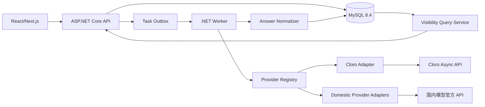

# AI Visibility SaaS 底层框架设计

> 文档性质：初始底层目标设计，2026-10-06 已核对其历史边界。本文保留早期方案，当前落地范围、启动方式和未实现项统一见 [README](../README.md) 及各功能说明。以下业务接口、表结构、状态机与验收标准不能作为现役能力的证明。

## 1. 目标与范围

本设计面向第一阶段“调通 Cloro 并保存大模型回答”，同时为后续接入 DeepSeek、通义千问、豆包、文心一言、Kimi 等国内模型保留稳定的 Provider 扩展边界。

第一阶段必须完成：

- 按租户、站点、Prompt 和 Engine 创建一次可追踪的 Visibility Run。
- 通过 Cloro 异步任务接口获取 ChatGPT、Gemini、Perplexity、Google AI Overview 的回答。
- 保存原始响应、标准化回答、引用、搜索词、模型版本和失败信息。
- 支持 Worker 重启、轮询超时、重复投递和部分失败恢复。
- 通过规划的 `/api/v1` REST API 查询运行进度和回答证据。

本阶段不把 Cloro 逻辑写进 HTTP Handler，不在浏览器调用 Cloro，也不把不同 Provider 的结果转换成同一种“模型分数”。

项目统一命名为 `Jogeoai`：

```text
Jogeoai.slnx
Jogeoai.Api
Jogeoai.Worker
Jogeoai.Domain
Jogeoai.Application
Jogeoai.Infrastructure
Jogeoai.Providers.Abstractions
Jogeoai.Providers.Cloro
Jogeoai.Providers.Domestic
```

根命名空间和项目名使用 `Jogeoai`；当前 Compose 项目名为 `jogeoai`，服务名为 `mysql`，默认数据库为 `jogeoai`。日志 `service.name` 属于后续可观测性配置，尚未注册。

## 1.1 项目位置与初始化状态

基础工程已经创建，当前目录结构如下，无需重新运行 `dotnet new`：

```text
Jogeoai.Api/
  Jogeoai.slnx
  src/                     .NET 项目
  scripts/                 本机环境与启动脚本
  docx/                    项目设计文档
  references/elmo/         只读参考源码
```

本机环境准备、启动、配置和调试方式统一见 [README](../README.md)。`references/elmo` 不加入解决方案，不安装其 Node/pnpm 依赖；它只作为源码和测试用例参考。

## 2. 技术选型

### 2.1 后端语言：ASP.NET Core

项目已使用 `.NET 10` 和 ASP.NET Core Web API；SDK 版本与滚动策略以根目录 `global.json` 为准。

这个选择适合本项目：

- Cloro 和国内模型调用以 HTTP、JSON、超时、重试和并发控制为主，`HttpClientFactory`、Polly 和 `CancellationToken` 已覆盖核心需求。
- `BackgroundService` 适合实现提交 Worker、轮询 Worker 和租约续期。
- ASP.NET Core、SqlSugar、MySqlConnector 和 Docker 在 Windows、macOS、Linux 上保持一致。
- Provider Adapter 直接基于 HTTP，不绑定某一家模型 SDK，后续国内模型可以复用同一套接口。
- 团队使用熟悉的 C#，维护成本低于引入另一套后端语言。

本后端仓库不包含产品前端；React/Next.js 是初始设计中的候选方案，实际前端选型以对应前端工程为准。前后端通过 HTTP / OpenAPI 合同对接，不要求语言一致。

### 2.2 HTTP API：REST + OpenAPI 3.1

业务 API 规划采用 REST，路径统一为 `/api/v1`；运行、检查、分页、取消、报告等资源适合 REST 表达。初始设计时仅有健康检查和自动生成的 OpenAPI JSON；现役业务接口已扩展，见 README 和运行环境 Swagger。本文中的 `api/openapi.yaml` 是目标产物，不是现有合同入口。

建议组合：

- API：ASP.NET Core Controllers；资源和状态机较多时比 Minimal API 更容易统一授权和审查。
- OpenAPI：`Microsoft.AspNetCore.OpenApi`，契约优先维护 `api/openapi.yaml`。
- 客户端/服务端代码生成：NSwag 或 Kiota，选择一种并固定版本。
- HTTP 客户端：`IHttpClientFactory` + Polly。
- 参数校验：FluentValidation。
- 错误格式：ASP.NET Core `ProblemDetails`，媒体类型为 `application/problem+json`。

创建运行采用异步语义：

```http
POST /api/v1/sites/{siteId}/visibility-runs
Idempotency-Key: <client-generated-key>
```

返回 `202 Accepted`、`Location` 和 Run 资源。API 不等待 Cloro 返回回答。

### 2.3 MySQL：MySQL 8.4 LTS

MySQL 8.4 LTS 作为主数据库，使用：

- InnoDB
- `utf8mb4` / `utf8mb4_0900_ai_ci`
- UTC 时间
- JSON 类型保存 Provider 原始响应和可演进字段
- `SELECT ... FOR UPDATE SKIP LOCKED` 实现首期任务领取
- `DECIMAL` 保存积分和费用，不使用浮点数

初始方案计划采用 SqlSugar；当前业务 Store 已使用 MySqlConnector 和显式 SQL，SqlSugarCore 仅引用包。以下是当时的候选设计：

- `SqlSugarCore`：实体映射、普通查询、事务和仓储封装。
- `MySqlConnector`：作为底层 ADO.NET 驱动。
- 任务领取、租约和 `SKIP LOCKED` 保留显式 SQL，通过 SqlSugar 的 `Ado`/事务能力执行，不把关键锁行为隐藏在通用仓储中。
- 使用 SqlSugar CodeFirst 或独立 SQL Migration；生产环境建议提交可审查的版本化 SQL，禁止应用启动时自动执行破坏性迁移。

SqlSugar 可以覆盖本项目的主要数据访问需求。只有在后续出现非常复杂的只读报表时，才考虑在 Infrastructure 中增加 Dapper；首期不需要 EF Core 和 Dapper 双栈。

### 2.4 队列与 Worker

首期使用 MySQL 任务表作为持久化队列，避免为了调通 Cloro 先引入 Redis 或 Kafka：

```text
API transaction
  -> outbox_events / provider_tasks
  -> worker lease
  -> submit / poll / normalize
```

当任务量增长到单实例无法满足吞吐时，再将任务投递到 Redis Streams、RabbitMQ 或 Kafka；业务层只依赖 `ITaskDispatcher` 接口，不改变 Provider 和证据模型。

### 2.5 macOS 与 Docker 开发环境

macOS 可以作为完整开发环境，建议所有开发依赖通过 Docker Compose 运行：

```text
MySQL 8.4
MinIO（可选，用于大 JSON 原始响应）
Mailpit（可选，用于本地邮件）
```

MySQL 使用官方镜像和命名卷。不要在 Compose 中固定 `platform: linux/amd64`；Apple Silicon 使用 `arm64` 原生镜像，Intel Mac 使用 `amd64`，这样可以避免 Rosetta 模拟造成性能和兼容性问题。

开发配置以根目录 [docker-compose.yml](../docker-compose.yml) 和 [.env.example](../.env.example) 为准，具体操作见 [README](../README.md)，此处不维护另一份 Compose 示例。

当前应用在宿主机运行，连接 `127.0.0.1:3306`；若将来容器化应用，应改用主机名 `mysql`。数据库账号、Cloro Key 和连接串通过本地环境变量或 User Secrets 注入，不提交真实密钥。

### 2.6 可观测性

- OpenTelemetry：Trace、Metric、Log correlation
- Prometheus：任务数量、延迟、错误率、Provider 状态
- Grafana：运行覆盖率、Cloro 排队时间、轮询耗时、费用
- Sentry 或等价错误平台：保存异常堆栈和任务上下文

日志中不得写入 API Key、完整 Authorization Header 或未脱敏的完整回答。

## 3. 逻辑架构



代码目录建议：

```text
src/
  Jogeoai.Api/             ASP.NET Core API、Controllers、中间件
  Jogeoai.Worker/          BackgroundService、任务领取和轮询
  Jogeoai.Domain/          Run、Check、Provider 抽象和领域规则
  Jogeoai.Providers.Abstractions/ Provider 接口和标准化 DTO
  Jogeoai.Providers.Cloro/         Cloro HTTP 客户端和响应解析
  Jogeoai.Providers.Domestic/      国内模型 Provider 实现
  Jogeoai.Infrastructure/ SqlSugar、MySQL、外部 HTTP、事务
  Jogeoai.Contracts/      OpenAPI DTO、ProblemDetails、枚举
tests/
  Jogeoai.UnitTests/
  Jogeoai.IntegrationTests/
db/
  migrations/                   MySQL 迁移
api/
  openapi.yaml                  API 契约
```

## 4. Provider 项目边界与语言决策

### 4.1 Provider 是否单独成项目

建议单独成 Class Library 项目，但首期不要单独部署成微服务：

```text
Jogeoai.Worker
  -> Jogeoai.Application
  -> IProviderRegistry
  -> IProviderAdapter
  -> Jogeoai.Providers.Cloro
```

Provider 项目只负责外部协议，不负责业务数据库和任务队列：

```text
Provider 项目负责：
  - Cloro/模型 API 请求和响应模型
  - HTTP 超时、错误分类和协议级重试建议
  - Provider 响应解析和 NormalizedAnswer 生成

Application/Worker 负责：
  - provider_tasks 持久化
  - 租约、轮询调度和任务状态机
  - 幂等、费用、租户和权限
  - 写入 visibility_checks、citations、mentions
```

API 项目不应直接引用 `Jogeoai.Providers.Cloro`，而应调用 Application 服务。只有 Worker 或 Infrastructure 的组合根注册具体 Provider：

```csharp
services.AddHttpClient<ICloroClient, CloroClient>(client =>
{
    client.BaseAddress = new Uri("https://api.cloro.dev/");
    client.Timeout = TimeSpan.FromSeconds(30);
});
services.AddSingleton<IProviderAdapter, CloroProvider>();
```

这样后续新增 `DeepSeekProvider` 或 `QwenProvider` 不需要修改 Run/Check 业务流程；如果将来某个 Provider 需要独立扩容，再把同一 Class Library 包装成独立 Worker/服务即可。

### 4.2 Provider 使用 Python 还是 .NET

首期统一使用 .NET/C#，不建议为了 Provider 另起 Python 服务：

- Cloro 和大多数国内模型都可以通过 HTTP/JSON 调用，不依赖 Python SDK。
- Provider 需要和 MySQL 任务、租约、重试、OpenTelemetry 使用同一套运行时，避免跨语言重复实现。
- .NET 的 `HttpClientFactory`、Polly、`BackgroundService` 和 `System.Text.Json` 已覆盖所需能力。
- 单一语言可以共享异常模型、日志字段、配置、密钥管理和部署流程。
- Python 服务会额外引入 RPC、服务发现、跨语言 DTO、独立发布和故障排查成本。

只有在以下情况出现时才考虑 Python：

1. 需要使用 Python 专属的评测、分词、Embedding、Reranker 或 NLP 库。
2. 某个 Provider 只有 Python SDK，并且官方 HTTP 接口不足以完成需求。
3. 已经存在稳定的 Python AI 平台团队和部署基础设施。

即使未来引入 Python，也建议把它放在独立的“分析/评测服务”，不要让 Cloro Provider 先变成 Python 微服务。回答采集、任务状态和证据保存仍由 .NET 主系统负责。

### 4.3 是否需要测试库和元数据层

不需要为 Cloro 单独建设一套 Provider 测试库，也不需要把回答先写入临时元数据库再同步到 API 数据库。生产数据可以直接进入 Jogeoai 的业务 MySQL，但写入路径应是：

```text
Cloro Provider
  -> NormalizedAnswer
  -> Application/Worker
  -> Jogeoai MySQL
```

Provider 不直接持有 `ISqlSugarClient`，不直接执行业务表 INSERT。这样可以保证回答、任务状态、积分预占和引用写入在同一个应用事务边界内管理。

“不保存元数据”不能理解为完全不保存任务信息。Cloro 是异步接口，至少需要保存以下最小运行字段，否则无法恢复轮询、避免重复提交和处理收费：

```text
provider_task_id
provider
task_type
check_id
状态
request_payload_hash
submitted_at / completed_at
retryable
error_code / error_message
```

这些是任务控制字段，不是额外的分析元数据。完整原始响应可以按产品的数据保留策略关闭或转存对象存储，但标准化回答、引用和积分账本不能省略。

开发、集成测试和生产仍应使用不同的数据库实例或数据库名，避免测试任务消耗真实 Cloro Key 和真实积分：

```text
本地 Docker：jogeoai（独立开发实例）
CI：临时 MySQL 容器
生产：独立 MySQL 实例
```

### 4.4 Elmo 参考路径索引

参考项目根目录：

```text
references/elmo/（相对于项目根目录）
```

以下路径是 Jogeoai 首期最需要阅读的文件。路径相对于上述 Elmo 根目录；文档中的链接可以直接打开对应源码。

| Jogeoai 要实现的部分 | Elmo 参考文件 | 阅读重点 |
|---|---|---|
| Provider 统一接口 | [`packages/lib/src/providers/types.ts`](../references/elmo/packages/lib/src/providers/types.ts) | `Provider`、`ScrapeResult`、`ProviderAccess` |
| Cloro 请求和轮询 | [`packages/lib/src/providers/registry/cloro.ts`](../references/elmo/packages/lib/src/providers/registry/cloro.ts) | taskType 映射、异步 Submit/Poll、超时和结果组装 |
| Cloro 测试样例 | [`packages/lib/src/providers/registry/cloro.test.ts`](../references/elmo/packages/lib/src/providers/registry/cloro.test.ts) | 完成、失败、超时、429、不同表面响应 |
| 通用轮询工具 | [`packages/lib/src/providers/registry/scrape-shared.ts`](../references/elmo/packages/lib/src/providers/registry/scrape-shared.ts) | 退避、瞬时错误、错误截断和 JSON 清理 |
| 回答文本解析 | [`packages/lib/src/text-extraction.ts`](../references/elmo/packages/lib/src/text-extraction.ts) | Cloro 的 `markdown`、`text`、`aioverview` 解析 |
| 文本解析测试 | [`packages/lib/src/text-extraction.test.ts`](../references/elmo/packages/lib/src/text-extraction.test.ts) | 普通回答和 Google AI Overview fixture |
| Provider 注册 | [`packages/lib/src/providers/index.ts`](../references/elmo/packages/lib/src/providers/index.ts) | Provider registry 和按 ID 解析 |
| Prompt 执行 Worker | [`apps/worker/src/jobs/process-prompt.ts`](../references/elmo/apps/worker/src/jobs/process-prompt.ts) | 批量任务、并发、部分失败、写入运行结果 |
| 定时调度 | [`apps/worker/src/jobs/schedule-maintenance.ts`](../references/elmo/apps/worker/src/jobs/schedule-maintenance.ts) | 到期 Prompt 查询和任务投递 |
| 报告生成 | [`apps/worker/src/jobs/generate-report.ts`](../references/elmo/apps/worker/src/jobs/generate-report.ts) | 异步报告状态和结果汇总 |
| 原始数据模型 | [`packages/lib/src/db/schema.ts`](../references/elmo/packages/lib/src/db/schema.ts) | brands、prompts、prompt_runs、citations |
| 指标计算 | [`packages/lib/src/report-metrics.ts`](../references/elmo/packages/lib/src/report-metrics.ts) | 可见性、Share of Voice 和聚合指标 |
| 查询分析 | [`apps/web/src/server/analytics-core.ts`](../references/elmo/apps/web/src/server/analytics-core.ts) | 趋势、品牌对比、引用聚合 |
| Provider 配置 | [`packages/config/src/scrape-targets.ts`](../references/elmo/packages/config/src/scrape-targets.ts) | `model:provider:version:online` 配置格式 |
| 环境变量注册 | [`packages/config/src/env-registry.ts`](../references/elmo/packages/config/src/env-registry.ts) | `CLORO_API_KEY` 的服务端配置方式 |
| Provider 成本 | [`packages/lib/src/usage/cost.ts`](../references/elmo/packages/lib/src/usage/cost.ts) | Provider 调用成本估算 |
| CLI Provider 配置 | [`apps/cli/src/providers.ts`](../references/elmo/apps/cli/src/providers.ts) | Cloro 支持的表面和配置提示 |
| 回答展示 | [`apps/web/src/components/response-markdown.tsx`](../references/elmo/apps/web/src/components/response-markdown.tsx) | Markdown 和不同 Provider 结果展示 |
| 引用展示 | [`apps/web/src/components/citations-display.tsx`](../references/elmo/apps/web/src/components/citations-display.tsx) | 引用列表、域名和链接展示 |

推荐阅读顺序：

```text
cloro.ts
  -> cloro.test.ts
  -> scrape-shared.ts
  -> text-extraction.ts / text-extraction.test.ts
  -> process-prompt.ts
  -> schema.ts
  -> report-metrics.ts / analytics-core.ts
  -> scrape-targets.ts / env-registry.ts / usage/cost.ts
```

Elmo 是 TypeScript/Pnpm 项目，Jogeoai 是 .NET/SqlSugar 项目，不要把 Elmo 的数据库 schema、队列实现或前端组件直接复制到 Jogeoai。应将其行为翻译成 C# 接口、SqlSugar 实体、MySQL Migration 和 `BackgroundService`。只有在复制具体代码时，才需要保留 Elmo 的 MIT 许可和版权声明。

## 5. Provider 抽象

业务层只调用统一接口，不依赖 Cloro 或某个国内模型的字段：

```csharp
public interface IProvider
{
    string Id { get; }
    AccessMode AccessMode { get; } // Scraped 或 Api
    Task EnsureSupportedAsync(Route route, CancellationToken ct);
    Task<SubmittedTask> SubmitAsync(SubmitInput input, CancellationToken ct);
    Task<PollResult> PollAsync(string externalTaskId, CancellationToken ct);
    Task<NormalizedAnswer> NormalizeAsync(ProviderResponse response, CancellationToken ct);
}

public sealed record SubmitInput(
    string Engine,
    string Prompt,
    string Language,
    string Country,
    Route Route);

public sealed record NormalizedAnswer(
    string Provider,
    string CaptureMode,
    string Engine,
    string? ModelId,
    string AnswerMarkdown,
    string AnswerText,
    bool AnswerPresent,
    IReadOnlyList<string> WebQueries,
    IReadOnlyList<Citation> Citations,
    JsonDocument RawOutput,
    DateTimeOffset CapturedAt);
```

`Provider` 只负责外部调用和响应标准化。品牌提及、竞品提及、推荐判断、Share of Voice 和 Visibility Score 属于 `visibility` 领域服务，不放进 Provider。

## 6. Cloro 首期适配器

### 6.1 路由映射

| Engine | Cloro taskType | payload 字段 | include |
|---|---|---|---|
| `OPENAI` | `CHATGPT` | `prompt` | `markdown=true, searchQueries=true` |
| `GEMINI` | `GEMINI` | `prompt` | `markdown=true` |
| `PERPLEXITY` | `PERPLEXITY` | `prompt` | `markdown=true` |
| `GOOGLE_AI_OVERVIEW` | `GOOGLE` | `query` | `aioverview.markdown=true` |

后续可扩展：

```text
GOOGLE_AI_MODE -> AIMODE
COPILOT        -> COPILOT
```

本设计的首期 Engine 范围不含 `COPILOT` 和 `GOOGLE_AI_MODE`；这是初始 Engine 范围，现役枚举和数据库约束以源码及已部署 schema 为准；后续扩展需同步 API 契约与数据模型。

### 6.2 请求流程

```http
POST https://api.cloro.dev/v1/async/task
Authorization: Bearer ${CLORO_API_KEY}
Content-Type: application/json
```

```json
{
  "taskType": "CHATGPT",
  "payload": {
    "prompt": "推荐适合小型企业的 CRM 软件",
    "country": "US",
    "include": {
      "markdown": true,
      "searchQueries": true
    }
  }
}
```

响应中的 `task.id` 必须先写入 MySQL，再进入轮询状态。轮询使用：

```http
GET https://api.cloro.dev/v1/async/task/{taskId}
```

请求中的 `country` 来自 Prompt 配置，不固定为 US。当前阶段只传 Cloro 已验证支持的字段；不要自行添加未经 Cloro 文档确认的 `language` 字段。

### 6.3 状态与超时

内部 Provider Task 状态：

```text
CREATED -> SUBMITTING -> QUEUED -> RUNNING -> COMPLETED
                                      └──────> FAILED
```

建议：

- 队列状态不设置短超时；Cloro 已接受的任务可能仍然计费。
- 开始运行后 10 分钟生成超时。
- 单任务总上限 60 分钟。
- 轮询间隔从 2 秒递增到 10 秒。
- `408`、`429`、`5xx` 进行指数退避。
- Cloro 已生成 `taskId` 后，Worker 重启只恢复轮询，禁止重新提交。
- 提交请求发生网络超时且无法确认是否创建成功时，标记 `SUBMISSION_UNKNOWN`，不要盲目重试。

### 6.4 响应标准化

- 普通表面优先读取 `response.markdown`，其次读取 `response.text`。
- Google AI Overview 读取 `response.aioverview.markdown`。
- `sources` 和 `citationPills` 合并后按 URL 去重。
- 搜索词读取 `searchQueries`、`search_model_queries`、`mapSearchQueries`。
- 模型版本读取答案对象的 `model`。
- `aioverview=null` 表示没有生成 Overview，属于“无回答证据”，不等于 Provider 调用失败。

## 7. MySQL 核心数据模型

### 7.1 `visibility_runs`

```text
id CHAR(36) PK
tenant_id CHAR(36) NOT NULL
site_id CHAR(36) NOT NULL
trigger_type ENUM('SCHEDULED','MANUAL','ONBOARDING')
status ENUM('QUEUED','RUNNING','SUCCEEDED','PARTIAL','FAILED','CANCELLED')
scoring_version INT NOT NULL
checks_total INT NOT NULL
checks_completed INT NOT NULL
checks_failed INT NOT NULL
coverage_rate DECIMAL(8,5)
visibility_score DECIMAL(8,3) NULL
created_at DATETIME(6)
started_at DATETIME(6) NULL
completed_at DATETIME(6) NULL
```

### 7.2 `visibility_checks`

```text
id CHAR(36) PK
run_id CHAR(36) NOT NULL
prompt_id CHAR(36) NOT NULL
engine VARCHAR(64) NOT NULL
sample_index SMALLINT NOT NULL
status ENUM('QUEUED','RUNNING','SUCCEEDED','FAILED','CANCELLED','SKIPPED')
evidence_class ENUM('API_BENCHMARK','OBSERVED_SERP')
provider VARCHAR(64) NOT NULL
model_id VARCHAR(128) NULL
tool_version VARCHAR(64) NULL
country CHAR(2) NOT NULL
language VARCHAR(35) NOT NULL
answer_present BOOLEAN NOT NULL DEFAULT TRUE
answer_markdown MEDIUMTEXT NULL
answer_text MEDIUMTEXT NULL
answer_excerpt VARCHAR(1000) NOT NULL
web_queries JSON NULL
raw_output_ref VARCHAR(500) NULL
raw_output_sha256 CHAR(64) NULL
failure_code VARCHAR(80) NULL
failure_message VARCHAR(1000) NULL
retryable BOOLEAN NOT NULL DEFAULT FALSE
observed_at DATETIME(6) NULL
created_at DATETIME(6)
```

唯一约束：

```text
UNIQUE(run_id, prompt_id, engine, sample_index)
```

### 7.3 `provider_tasks`

```text
id CHAR(36) PK
check_id CHAR(36) NOT NULL
provider VARCHAR(64) NOT NULL
external_task_id VARCHAR(128) NULL
task_type VARCHAR(64) NOT NULL
status VARCHAR(32) NOT NULL
request_payload_hash CHAR(64) NOT NULL
lease_owner VARCHAR(128) NULL
lease_until DATETIME(6) NULL
poll_attempts INT NOT NULL DEFAULT 0
last_polled_at DATETIME(6) NULL
submitted_at DATETIME(6) NULL
started_at DATETIME(6) NULL
completed_at DATETIME(6) NULL
error_code VARCHAR(80) NULL
error_message VARCHAR(1000) NULL
created_at DATETIME(6)
updated_at DATETIME(6)
```

唯一约束：

```text
UNIQUE(provider, external_task_id)
UNIQUE(check_id, provider)
```

### 7.4 `visibility_citations` 和 `visibility_mentions`

引用表保存：

```text
check_id
ordinal
url
domain
title
tracked_domain
```

提及表保存：

```text
check_id
entity_type
competitor_id
matched_name
sentiment
ordinal
confidence
```

### 7.5 `outbox_events` 和 `usage_events`

`outbox_events` 保证数据库提交成功后任务一定能被 Worker 发现；`usage_events` 记录每次 Provider 调用、成功/失败、Provider、Engine、租户和预估费用。

Cloro 费用可能在 Worker 进程退出后仍然发生，因此不能只按成功写账；提交成功后就要产生一条可结算的 usage event。

### 7.6 套餐与积分账本

套餐和积分必须拆开建模：套餐定义权限与额度，积分账本记录真实可消费余额。

#### 核心表

`plans`

```text
id
code                 FREE / STARTER / PRO
name
monthly_price
monthly_credits
max_sites
max_prompts
max_concurrency
enabled
```

`subscriptions`

```text
id
tenant_id
plan_id
status               TRIALING / ACTIVE / PAST_DUE / CANCELLED
current_period_start
current_period_end
external_customer_id
external_subscription_id
```

`credit_accounts`

```text
id
tenant_id UNIQUE
available_credits
reserved_credits
currency             CREDIT
version              乐观锁版本
```

`credit_ledger`

```text
id
tenant_id
account_id
entry_type           WELCOME_GRANT / PLAN_GRANT / PURCHASE / RESERVE
                     CAPTURE / RELEASE / REFUND / EXPIRE / ADJUSTMENT
amount               有符号整数
reference_type
reference_id
idempotency_key UNIQUE
expires_at NULL
created_at
```

`credit_reservations`

```text
id
tenant_id
account_id
run_id
amount
status               HELD / CAPTURED / RELEASED / EXPIRED
idempotency_key UNIQUE
created_at
captured_at NULL
released_at NULL
```

账本是审计事实，`credit_accounts` 是余额缓存。任何余额变化必须在同一个数据库事务中同时写入余额和账本，禁止直接执行 `balance = balance - 10` 而不写明细。

#### 注册赠送 500 积分

注册流程在一个事务中完成：

```text
创建用户
创建默认 tenant
创建 FREE subscription
创建 credit_account
写入 WELCOME_GRANT +500
```

赠送记录使用 `WELCOME:{tenantId}` 作为幂等键，防止注册重试重复赠送。建议给注册赠送设置有效期，例如 30 天；如果产品要求永久有效，只需将 `expires_at` 设为 NULL，不改变其他模型。

#### 消耗规则

建议把一次“Prompt × Engine × Sample”定义为一个计费 Check：

```text
1 check = 10 credits
```

因此：

```text
1 个 Prompt，1 个 Engine，1 次采样 = 10 积分
1 个 Prompt，4 个 Engine，1 次采样 = 40 积分
1 个 Prompt，2 个 Engine，3 次采样 = 60 积分
```

这样积分消耗和 Cloro 实际外部任务数一致，也能防止用户通过同时选择多个模型绕过成本控制。若产品坚持“同一个问题无论选几个模型都只扣 10 分”，应把它定义为套餐权益并限制每次最多一个 Engine；不建议第一版采用无限多模型统一 10 分的规则。

#### 预占、扣除和释放

创建 Run 时：

1. 计算预计费用：`checks_total × 10`。
2. 锁定 `credit_accounts` 行。
3. 校验 `available_credits >= amount`。
4. `available_credits -= amount`，`reserved_credits += amount`。
5. 写入 `credit_reservations(HELD)` 和 `RESERVE` 账本记录。
6. 创建 Run、Checks 和 Outbox 任务。

Cloro 返回外部 `taskId` 后，将对应 Check 的预占积分 `CAPTURE`。如果明确任务没有提交成功，则 `RELEASE`；如果提交状态未知，积分继续保持 `HELD`，直到任务对账完成，避免重复扣费或重复提交。

Run 部分成功时，只扣除已经提交并计费的 Check；未提交的 Check 释放预占。所有 Capture、Release 和 Refund 都必须使用业务幂等键。

余额不足时 API 返回 `402 Payment Required`，错误码建议为：

```text
INSUFFICIENT_CREDITS
```

#### 套餐升级和付费

月度套餐的月度积分通过 `PLAN_GRANT` 入账；购买额外积分通过 `PURCHASE` 入账。支付平台只通过签名 Webhook 改变订阅和账本，不允许前端直接增加积分。支付平台可以先抽象为 `IBillingGateway`，首期接入哪一家不影响积分模型。

## 8. 任务领取与幂等

Worker 使用租约领取任务：

```sql
SELECT id
FROM provider_tasks
WHERE status IN ('CREATED', 'QUEUED', 'RUNNING')
  AND (lease_until IS NULL OR lease_until < UTC_TIMESTAMP(6))
ORDER BY created_at
LIMIT 50
FOR UPDATE SKIP LOCKED;
```

领取后更新：

```text
lease_owner = worker instance id
lease_until = now + 60 seconds
```

长任务通过心跳续租；租约失效后其他 Worker 可以恢复轮询。

幂等要求：

1. Run 创建使用 `Idempotency-Key`。
2. Check 使用 `(run_id, prompt_id, engine, sample_index)` 唯一键。
3. Provider Task 的外部 ID 唯一。
4. 已有外部 Task ID 时只允许 Poll，不允许重新 Submit。
5. 只有确定“请求尚未发出”时才允许重新提交。

## 9. API 设计

初始接口草案如下；当前路由与实现范围以 README 和运行环境 Swagger 为准：

```text
POST /api/v1/sites/{siteId}/visibility-runs
GET  /api/v1/visibility-runs/{runId}
POST /api/v1/visibility-runs/{runId}/cancel
GET  /api/v1/visibility-runs/{runId}/checks
GET  /api/v1/visibility-checks/{checkId}
GET  /api/v1/sites/{siteId}/visibility-metrics
```

首期不新增 `/cloro/*` 公开接口。Cloro 是内部 Provider，前端只看到统一的 Run 和 Check。

建议 `VisibilityCheckDetail` 增加：

```yaml
captureMode:
  type: string
  enum: [api, scraped]
answerPresent:
  type: boolean
country:
  type: string
webQueries:
  type: array
  items: { type: string }
sampleIndex:
  type: integer
```

## 10. 国内模型扩展方式

未来国内模型统一归入 `api` Provider，和 Cloro 的 `scraped` 结果保持证据隔离：

```text
DeepSeek   -> deepseek-api
通义千问   -> qwen-api
豆包       -> doubao-api
文心       -> ernie-api
Kimi       -> kimi-api
```

各 Adapter 只实现：

```text
Submit / Invoke
Normalize
Extract citations
Extract usage
```

业务层不感知供应商字段。统一结果仍然进入 `visibility_checks`，但：

```text
provider = deepseek-api
evidence_class = API_BENCHMARK
capture_mode = api
```

如果国内模型支持联网搜索，仍要区分“模型 API 自带搜索”和“真实消费端页面抓取”，不能因为有引用就把它标记为 `OBSERVED_SERP`。

## 11. 安全、租户和数据保留

- API Key 只存在服务端 Secret Manager 或加密配置中。
- 所有表包含 `tenant_id` 或可以通过外键稳定回溯到租户。
- 每个查询先解析租户上下文，再执行 SQL。
- 原始回答可能包含用户输入或敏感信息，默认限制访问角色和保留时间。
- 日志只记录 `run_id`、`check_id`、`provider_task_id`，不打印完整回答。
- 对 Prompt 和回答设置最大长度，防止异常 Provider 响应撑爆数据库。
- Provider 域名使用 HTTPS 和出站 allowlist。

## 12. 首期实施顺序

### 第 1 步：基础工程

- 初始化 ASP.NET Core API 和 .NET Worker。
- 建立 SqlSugar 数据访问、版本化 Migration 和事务封装。
- 完成租户、站点、Prompt、Run、Check 的最小表。
- 生成 OpenAPI Server/Client 类型。

### 第 2 步：Cloro 单任务打通

- 实现 `CloroProvider` 和 `IProvider` 注册。
- 先支持 `CHATGPT`。
- 完成 Submit、Poll、Normalize。
- 使用固定测试 Prompt 做一次真实沙盒调用。

### 第 3 步：任务持久化

- 加入 `provider_tasks`、租约和 Outbox。
- 验证 Worker 重启后能继续 Poll。
- 验证同一 Check 不会重复提交。

### 第 4 步：四种 Cloro 表面

- ChatGPT
- Gemini
- Perplexity
- Google AI Overview

### 第 5 步：证据和指标

- 引用去重。
- 品牌/竞品提及识别。
- `mentionRate`、`citationRate`、`coverageRate`。
- `scoringVersion` 版本化。

### 第 6 步：国内 API Provider

- 先接入一个 OpenAI-compatible 国内模型。
- 再接入需要专用协议的模型。
- 增加按租户配置 Provider Key、限额和费用账本。

## 13. 验收标准

首期完成的标准是：

1. 创建 Visibility Run 返回 `202`，而不是等待 Cloro 完成。
2. Cloro 返回的外部 Task ID 可在 MySQL 中查询。
3. API 或 Worker 重启后可以继续轮询。
4. 同一 Check 重复投递不会产生第二个 Cloro Task。
5. ChatGPT 和 Google AI Overview 的回答都能正确提取。
6. 引用 URL 去重并保留顺序。
7. 失败任务保存错误码、错误信息和是否可重试。
8. `GET /visibility-checks/{id}` 能返回回答、引用和提及。
9. Cloro 结果明确标记为 `scraped / OBSERVED_SERP`。
10. 后续新增国内模型时不需要修改 Run、Check、Citation 的业务流程。

本设计参考了 Elmo 的 Provider、Cloro 异步任务和答案标准化模式，但只复用抽象和数据流设计。若复制 Elmo 的具体代码，应保留其 MIT 许可和版权声明。
