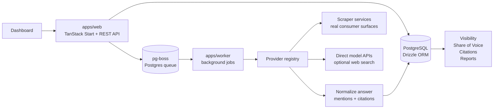

# Elmo 架构与页面参考

> 本文记录 Elmo 参考系统及早期调研建议。Jogeoai 当前实现见 [README](../README.md)，后续技术选型与实施顺序以 [底层框架设计](cloro-foundation-design.md) 为准。Elmo 的 PostgreSQL/TypeScript 栈不代表本项目运行栈。

这份文档记录从 [elmohq/elmo](https://github.com/elmohq/elmo) 拉取的代码、架构观察和本项目的复刻建议。Elmo 源码位于 `references/elmo`，本次拉取使用浅克隆，基线 commit 为 `f74296c9b33734652c4819bf94af3b343763af03`，仓库版本为 `0.2.13`。

## 1. 先确认 Elmo 监控的是什么

Elmo 不是只调用一个大模型 API，也不是普通 SEO 爬虫。它通过统一的 Provider 接口同时支持两条路径：

- `scraped`：借助 Cloro、Bright Data、Oxylabs、Olostep、DataForSEO 等服务访问 ChatGPT、Google AI Mode、Google AI Overview、Gemini、Perplexity、Copilot 等消费端页面，结果更接近用户实际看到的页面。
- `api`：直接调用 OpenAI、Anthropic、Mistral、OpenRouter 等模型 API，可以打开 web search，但不等于 ChatGPT 或 Google AI 的实际产品页面。

这两条路径在代码中由 `ProviderAccess = "scraped" | "api"` 明确区分。统一结果类型是 `ScrapeResult`，包含：

```text
textContent       规范化后的回答文本
rawOutput         Provider 返回的原始结果
webQueries        AI 为回答问题实际执行的搜索词（可能不可用）
citations         引用 URL、域名、标题和顺序
modelVersion      模型或 Provider 版本
```

相关源码：

- `references/elmo/packages/lib/src/providers/types.ts`
- `references/elmo/packages/lib/src/providers/runner.ts`
- `references/elmo/packages/config/src/scrape-targets.ts`
- `references/elmo/packages/docs/content/docs/user-guide/providers.mdx`

Provider 通过环境变量配置，格式为：

```text
model:provider[:version][:online]
```

例如：

```text
chatgpt:brightdata:online
google-ai-mode:brightdata:online
chatgpt:openai-api:gpt-5-mini:online
claude:anthropic-api:claude-sonnet-5
```

因此，Elmo 的“网页监控”成立的前提是配置了 scraper Provider；如果配置的是 `openai-api` 或 `anthropic-api`，得到的是 API 答案。

## 2. Elmo 的运行架构



源码采用 pnpm + Turborepo monorepo：

| 目录 | 职责 | 本项目参考价值 |
|---|---|---|
| `apps/web` | Dashboard、REST API、鉴权和页面路由 | 参考页面布局和 BFF/API 组织方式 |
| `apps/worker` | 调度 Prompt、执行 Provider、生成报告 | 参考异步任务和重试机制 |
| `apps/cli` | Docker Compose、初始化、升级和迁移 | 参考自部署交付方式 |
| `packages/lib` | 数据库、Provider、指标、鉴权、业务逻辑 | 参考核心领域模型 |
| `packages/config` | 环境变量、模型目标和计划配置 | 参考 Provider 配置格式 |
| `packages/ui` | 共用 UI 组件和设计 tokens | 参考卡片、表格、图表、筛选器 |
| `packages/api-spec` | OpenAPI 规范 | 参考外部 API 的资源边界 |
| `e2e` | Playwright、API 和任务流测试 | 参考端到端验收场景 |

关键工作流在：

- `references/elmo/apps/worker/src/jobs/process-prompt.ts`：执行一次 Prompt、调用 Provider、解析答案、写入结果。
- `references/elmo/apps/worker/src/jobs/schedule-maintenance.ts`：查找到期 Prompt，向队列投递任务。
- `references/elmo/apps/worker/src/jobs/generate-report.ts`：生成可分享报告。
- `references/elmo/packages/lib/src/providers/registry/`：每个 scraper/API Provider 的适配器。
- `references/elmo/apps/web/src/server/visibility.ts`、`analytics-core.ts`：可见性和聚合查询。

## 3. 数据模型

Elmo 用 PostgreSQL + Drizzle，最值得参考的是“原始结果和聚合指标同时保留”，而不是只保存一个最终分数。

核心表位于 `references/elmo/packages/lib/src/db/schema.ts`：

| 表 | 作用 | 本项目建议 |
|---|---|---|
| `brands` | 品牌、官网、别名、附加域名、启用模型 | 增加语言、地区和品牌类型 |
| `prompts` | 要持续追踪的问题、标签、启用状态 | 增加意图、Persona、问题模板版本 |
| `competitors` | 竞品名称、域名、别名 | 保留，用于 Share of Voice |
| `prompt_runs` | 每一次模型/网页采集的原始结果和品牌检测结果 | 增加 `capture_mode`、地区、语言和采集 Provider |
| `citations` | 引用 URL、域名、标题和引用序号 | 增加来源类型和是否为自有域名 |
| `reports` | 报告生成状态和结果 | 保留异步状态机 |
| `brand_opportunities` | 根据数据生成的优化机会 | MVP 可延后 |
| `usage_events` | Provider 调用次数和估算成本 | 建议第一版就保留 |
| `secrets` | 加密后的 Provider 凭证 | 不要把 Key 放在浏览器或明文数据库 |

每条采集记录至少应保存：Prompt、品牌、Provider、模型版本、采集模式、时间、语言、地区、原始答案、引用、解析版本和错误信息。这样以后更换识别算法时可以重新计算，而不必重新消耗 API 或抓取额度。

## 4. 页面设计参考

Elmo 的页面不是把所有指标塞到一个大表里，而是按“总览 → 趋势 → 对比 → 原始证据”逐层下钻。

### 页面层级

```text
品牌工作区
├── Overview             总可见性、Share of Voice、趋势、运行状态
├── Visibility           按 Prompt 查看可见性趋势
├── Share of Voice       品牌与竞品排名、提及量、占比
├── Query Fan-Out        AI 实际扩展出的搜索问题
├── Citations            被引用的 URL、域名、变化和内容缺口
├── Opportunities         优化机会和行动建议
└── Settings
    ├── Brand             品牌、域名、别名
    ├── Competitors       竞品
    ├── Prompts           Prompt 管理
    └── LLMs              模型和 Provider
```

### 视觉语言

- 左侧固定导航，内容区采用大留白和单列卡片。
- 页面标题下放置筛选器：模型、标签、时间范围、排序和搜索。
- 关键数字使用大字号 KPI 卡片，例如 `71% Visibility`、`14% Share of Voice`。
- 趋势图使用浅色填充区域，颜色只用来区分指标或品牌。
- 表格显示排名、品牌、提及量、占比和 Prompt 数量；当前品牌使用 `You` 标记。
- 详情页先展示指标和时间范围，再展示模型、版本、采集时间、引用和完整原始回答。
- 原始答案必须能下钻查看，这是验证“品牌到底有没有出现”的证据层。

### 对应源码和截图

页面路由：

- `references/elmo/apps/web/src/routes/_authed/app/org/$org/brand/$brand/index.tsx`
- `references/elmo/apps/web/src/routes/_authed/app/org/$org/brand/$brand/visibility.tsx`
- `references/elmo/apps/web/src/routes/_authed/app/org/$org/brand/$brand/share-of-voice.tsx`
- `references/elmo/apps/web/src/routes/_authed/app/org/$org/brand/$brand/prompts/$promptId.tsx`
- `references/elmo/apps/web/src/routes/_authed/app/org/$org/brand/$brand/citations.tsx`

共用组件：

- `references/elmo/apps/web/src/components/app-shell.tsx`
- `references/elmo/apps/web/src/components/app-sidebar.tsx`
- `references/elmo/apps/web/src/components/page-header.tsx`
- `references/elmo/apps/web/src/components/full-page-card.tsx`
- `references/elmo/apps/web/src/components/trend-chart.tsx`
- `references/elmo/apps/web/src/components/share-of-voice-donut.tsx`
- `references/elmo/apps/web/src/components/response-markdown.tsx`
- `references/elmo/apps/web/src/components/filter-bar.tsx`

本地截图：

- [Overview](../references/elmo/apps/www/public/screenshots/overview.png)
- [Visibility](../references/elmo/apps/www/public/screenshots/visibility.png)
- [Share of Voice](../references/elmo/apps/www/public/screenshots/share-of-voice.png)
- [Prompt Detail](../references/elmo/apps/www/public/screenshots/prompt-detail.png)
- [Citations](../references/elmo/apps/www/public/screenshots/citations.png)

## 5. 早期调研建议（历史参考）

建议采用“参考 Elmo 架构，重写本项目 Provider 和品牌业务”的方式，而不是直接把 Elmo 改成中文版本。原因是 Elmo 的页面、任务队列和数据模型比较成熟，但它的网页采集依赖第三方服务，国内模型和本地化指标仍需要自己定义。

以下技术边界和 API Provider 优先顺序属于早期候选方案，已由底层框架设计中的 .NET / MySQL / Cloro 优先方案替代。保留示例用于理解参考系统，勿据此配置本项目。

### 早期候选技术边界

```text
Web/API             React + 现有项目框架
任务调度             PostgreSQL queue 或 Redis queue
数据库               PostgreSQL
采集层               Provider Adapter
分析层               确定性规则 + 可选 LLM 判定
前端                 Elmo 的页面层级和信息密度
```

Provider 统一接口建议先固定成：

```ts
type CaptureMode = "api" | "scraped";

type AnswerSnapshot = {
  engine: string;
  provider: string;
  model?: string;
  captureMode: CaptureMode;
  prompt: string;
  answerText: string;
  rawOutput: unknown;
  citations: Array<{
    url: string;
    domain: string;
    title?: string;
    position?: number;
  }>;
  webQueries?: string[];
  locale?: string;
  country?: string;
  capturedAt: string;
};
```

第一阶段先实现 API Provider，第二阶段再加入真实网页采集：

1. **MVP 数据闭环**：品牌、别名、竞品、Prompt、API 调用、原始答案、品牌提及和历史趋势。
2. **Elmo 风格页面**：Overview、Visibility、Share of Voice、Prompt Detail、Citations。
3. **国内模型适配**：按官方 API 接入 DeepSeek、豆包、通义、文心等，并统一返回 `AnswerSnapshot`。
4. **成本和任务治理**：重试、限流、每次调用成本、失败原因和 Provider 健康状态。
5. **网页采集**：只接入经过评估的 scraper 服务，保留 `capture_mode=scraped`，不要把网页结果和 API 结果混成一类。
6. **多租户和报告**：组织、成员、权限、定时报告和导出。

### 先做哪些指标

```text
mention_rate          回答提到品牌的比例
citation_rate         回答引用品牌域名的比例
recommendation_rate   明确推荐品牌的比例
share_of_voice        品牌提及量 / 所有竞品提及量
average_position      品牌首次出现或推荐列表中的平均位置
sentiment             正面 / 中性 / 负面
```

相同 Prompt 不能只采集一次。第一版建议每次运行至少采样 3 次，并保存模型、版本、地区、语言、采集方式和原始回答。仪表盘显示“样本数”和“最后更新时间”，不要把一次随机回答包装成稳定排名。

## 6. 哪些代码适合直接借鉴

适合重点阅读或移植设计：

- Provider 抽象：`packages/lib/src/providers/types.ts`
- Provider 注册表：`packages/lib/src/providers/registry/`
- Prompt 调度：`apps/worker/src/jobs/process-prompt.ts`
- 定时维护：`apps/worker/src/jobs/schedule-maintenance.ts`
- 数据库模型：`packages/lib/src/db/schema.ts`
- 指标和 Share of Voice：`packages/lib/src/report-metrics.ts`、`apps/web/src/server/analytics-core.ts`
- 页面结构：`apps/web/src/routes/` 和 `apps/web/src/components/`
- OpenAPI 资源设计：`packages/api-spec/src/openapi.json`

不建议直接复制：

- Elmo 的商业抓取 Provider 配置和供应商绑定关系。
- 面向 Cloud、White-label、Stripe 的计费和部署代码。
- 还没有经过本项目数据验证的评分权重。
- 直接使用网页自动化替代官方 API；这会增加账号、验证码、服务条款和页面变化风险。

## 7. 参考链接

- [Elmo 源码](https://github.com/elmohq/elmo)
- [Elmo Provider 文档](https://www.elmohq.com/docs/user-guide/providers)
- [Elmo 架构文档](https://www.elmohq.com/docs/developer-guide/architecture)
- [Elmo API 文档](https://www.elmohq.com/docs/api)

## 8. 代码使用和更新

Elmo 仓库声明使用 MIT License。如果从 `references/elmo` 复制代码到本项目，应保留原仓库的 `LICENSE.md` 和版权声明，并单独记录修改来源。本次只拉取和阅读参考代码，没有修改 Elmo 子仓库，也没有安装其依赖或启动服务。

只有需要更新参考基线时才执行以下命令，并同步本文的基线 commit；日常 .NET 环境搭建不需要更新参考代码：

```powershell
git -C references/elmo pull --ff-only
git -C references/elmo rev-parse HEAD
```

如果需要完整提交历史，再执行：

```powershell
git -C references/elmo fetch --unshallow
```
