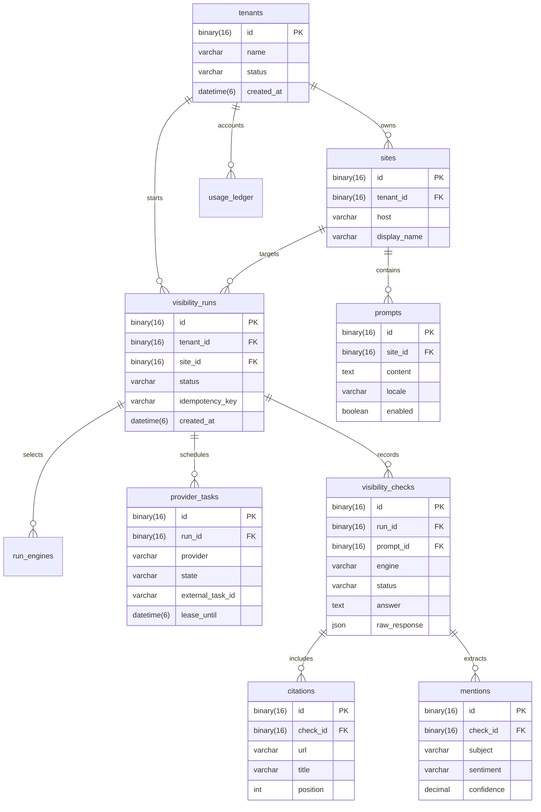

# Jogeoai 首期业务数据库设计 PRD

## 1. 文档目的

本文定义 Jogeoai AI 可见性服务首期业务数据库的产品需求、数据边界和落库约束，作为后续领域模型、API、Worker 和 SQL migration 的共同输入。

本文是早期首期业务数据库目标 PRD，保留原始范围和迁移顺序作为设计依据，不是当前实现清单。当前代码、已实现接口、知识库能力和运行库迁移状态以 [README.md](README.md)、`src/`、`db/migrations/` 和对应 `.trellis/tasks/` 实施记录为准；本文未覆盖的后续实现不能据此推断为已部署。

## 2. 背景与目标

用户需要针对一个站点提交一组 Prompt，让一个或多个回答引擎执行检查，并能在异步任务完成后查询回答、引用、搜索词和失败原因。系统必须支持 Worker 重启、重复投递和 Provider 部分失败恢复。

首期数据库需要做到：

- 隔离租户、站点、Prompt 和运行记录。
- 用可恢复的任务记录承载 Provider Submit/Poll 生命周期。
- 保存标准化回答，同时保留受控大小的 Provider 原始响应。
- 让引用和提及可以独立查询、去重和分页。
- 通过幂等键防止客户端重复创建运行。
- 让积分预占、结算和退款有可审计记录。
- 所有时间使用 UTC；金额和积分使用定点数。

## 3. 非目标

本期不实现前端、登录与组织权限、计费支付、实时 WebSocket、全文搜索、向量检索、Provider 独立数据库或 Redis/Kafka 队列。首期以 MySQL 任务表作为持久化队列，后续可在不改变业务记录的情况下替换调度实现。

## 4. 核心业务流程

```text
API 创建 visibility_run
  -> 同事务写 provider_tasks 与 outbox_events
  -> Worker 领取任务并设置租约
  -> Provider Submit / Poll
  -> 写入 visibility_checks、citations、mentions
  -> 完成积分结算与运行聚合
  -> API 分页查询运行和证据
```

所有跨表写入必须在 Application/Worker 的事务边界内完成；Provider 适配器只返回协议结果，不直接写业务表。

## 5. 逻辑模型



## 6. 表设计要求

### 6.1 `tenants`

租户根实体。`id` 使用 UUID 的 16 字节二进制存储；`status` 首期为 `active`、`suspended`、`deleted`。删除采用软删除字段，不物理删除存在运行记录的租户。

### 6.2 `sites`

租户下的站点或品牌域名。`host` 保存规范化小写域名，不包含协议、路径和尾部斜杠；同一租户内唯一。站点停用后不能创建新运行，但历史运行仍可查询。

### 6.3 `prompts`

站点的检查问题模板。保存原文、语言和启用状态；内容变更不覆盖历史检查使用的文本，创建运行时应把 Prompt 快照写入运行明细或检查记录。

### 6.4 `visibility_runs`

一次用户可追踪的检查批次。建议字段：`status`（`queued`、`running`、`succeeded`、`partial_failed`、`failed`、`cancelled`）、`requested_by`、`requested_at`、`started_at`、`completed_at`、`total_checks`、`succeeded_checks`、`failed_checks`、`error_code`、`error_message`、`created_at`、`updated_at`。

`(tenant_id, idempotency_key)` 唯一，客户端使用 `Idempotency-Key` 创建运行；相同键必须返回同一运行，不重复扣费或提交 Provider 任务。

### 6.5 `run_engines`

运行选择的回答引擎快照。保存 `engine`、可选的 `provider`、请求参数 JSON 和排序序号。该表避免后续修改站点默认引擎影响历史运行。

### 6.6 `provider_tasks`

持久化 Provider 异步任务和 Worker 租约。建议字段：`provider`、`operation`（`submit`/`poll`）、`state`（`pending`、`leased`、`submitted`、`polling`、`succeeded`、`retryable_failed`、`terminal_failed`）、`external_task_id`、`attempt_count`、`next_attempt_at`、`lease_owner`、`lease_until`、`last_error_code`、`last_error_message`、`provider_request`、`provider_response`、`created_at`、`updated_at`。

领取任务使用事务加 `SELECT ... FOR UPDATE SKIP LOCKED`；租约过期后任务可再次领取。`(provider, external_task_id)` 在非空时唯一，防止重复提交结果。

### 6.7 `visibility_checks`

一个 Prompt 与一个引擎的一次实际检查结果。保存 Prompt 文本快照、模型版本、回答正文、搜索词 JSON、标准化状态、耗时、费用、原始响应引用和错误信息。`raw_response` 必须设置大小上限或转对象存储；严禁记录 API Key、Authorization Header。

推荐唯一键：`(run_id, prompt_id, engine)`。如未来支持同一组合重试，使用 `attempt` 字段而不是覆盖已完成结果。

### 6.8 `citations`

回答引用的规范化 URL、标题、来源域名、回答中的顺序和抓取时间。URL 需在写入时去除明显追踪参数并限制长度；同一检查内使用 `(check_id, normalized_url, position)` 去重。

### 6.9 `mentions`

从回答中抽取的品牌或主题提及。保存 `subject`、`matched_text`、`sentiment`、`confidence`、字符位置和抽取器版本。提及是证据，不在数据库层计算“模型分数”；聚合分数属于后续查询/分析需求。

### 6.10 `usage_ledger`

租户积分和费用的不可变流水。每条记录包含 `tenant_id`、`run_id`、`entry_type`（`reserve`、`charge`、`release`、`refund`）、`units`、`amount`、`currency`、`reference`、`created_at`。`reference` 用于幂等，禁止通过更新历史流水来修正余额；余额由流水聚合或单独投影表维护。

### 6.11 `outbox_events`

事务消息表，用于在创建运行的同一事务中发布任务事件。保存 `event_type`、`aggregate_type`、`aggregate_id`、JSON `payload`、`status`、`available_at`、`published_at` 和重试信息。发布失败可重试，不能阻塞 API 读请求。

## 7. 公共数据库约束

- 引擎、Provider、状态和错误码使用 `VARCHAR` 加应用层枚举，避免 MySQL `ENUM` 阻碍演进。
- 主键统一 UUID；外键列和索引使用相同类型与长度。
- 金额使用 `DECIMAL(18, 6)`，积分使用 `DECIMAL(18, 3)`；不使用浮点数。
- 文本和 JSON 字段按最小必要长度设计，所有表使用 InnoDB、`utf8mb4`、`utf8mb4_0900_ai_ci`。
- 时间列使用 `DATETIME(6)`，应用统一写 UTC；对外响应由 API 层格式化为 ISO 8601。
- 所有租户业务表必须带 `tenant_id` 或能通过外键稳定追溯租户；查询服务默认强制租户过滤。
- 迁移按编号提交到 `db/migrations/`，生产不允许应用启动自动执行破坏性迁移。

## 8. 索引与查询验收

- `visibility_runs`：`(tenant_id, created_at)`、`(site_id, created_at)`、`(tenant_id, idempotency_key)` 唯一。
- `provider_tasks`：`(state, next_attempt_at)`、`(lease_until)`、`(run_id)`、`(provider, external_task_id)` 唯一（外部任务 ID 非空时）。
- `visibility_checks`：`(run_id, status)`、`(prompt_id, engine, created_at)`。
- `citations`、`mentions`：`(check_id, position)` 与 `(check_id, subject)`。
- 运行列表、检查明细、引用列表均使用稳定排序和游标分页，不使用无限制 `SELECT *`。

验收数据集应覆盖：空结果、Provider 超时、重复 Idempotency-Key、租约过期重试、部分成功运行、超长原始响应和跨租户访问拦截。

## 9. 迁移实施顺序

以下是本文编写时的规划顺序，当前实现已超出该阶段基线；新增结构仍必须按编号 migration 手动部署：

1. （已完成）建立 `tenants`、`sites`、`prompts` 和 `run_engines`。
2. （已完成）建立 `visibility_runs`、`provider_tasks` 和 `outbox_events`。
3. （已完成）建立 `visibility_checks`、`citations`、`mentions` 的基础结构。
4. （已完成）建立 `usage_ledger` 基础流水表；任务提交和完成边界的应用层结算仍待实现。
5. 增加租户过滤、分页查询和归档策略，再评估对象存储与报表索引。

每一步都必须配套可重复执行的 SQL migration、回滚说明（如适用）和最小集成验证；在业务表实现前，不修改现有 `001_cloro_provider_settings.sql` 的职责。

## 10. 完成标准

- 能创建一个带幂等键的运行，并在数据库中追踪到对应 Provider 任务。
- Worker 重启或租约过期后，任务可继续处理且不会生成重复外部任务。
- 成功、部分失败和终态失败均能查询到清晰状态和错误码。
- 回答、引用、搜索词、模型版本和原始响应可以按运行分页查询。
- 任意租户查询都不会读取其他租户的运行或证据。
- 迁移在空库和已有 `cloro_provider_settings` 的开发库上均可执行。
